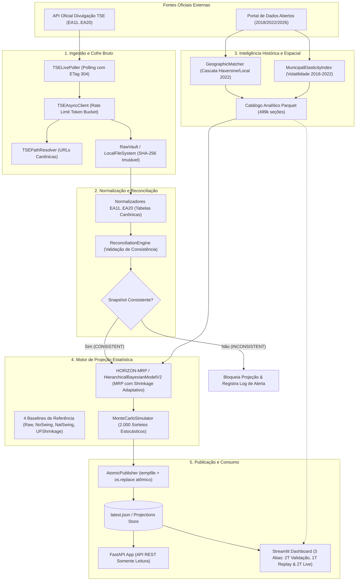

# Mapa de Arquitetura e Componentes · Horizonte Eleitoral

Este documento é o **Mapa Canônico** do projeto Horizonte Eleitoral. Ele define o que existe no repositório, onde reside cada componente, quais são suas fronteiras de isolamento e como a informação flui do início ao fim do sistema.

---

## 1. Visão Geral da Arquitetura

O Horizonte Eleitoral foi concebido como uma arquitetura orientada a dados imutáveis, inspirada em princípios funcionais e de segregação de responsabilidades (*Separation of Concerns*). 

A premissa central é que **o motor preditivo estatístico nunca deve realizar operações de I/O (rede, banco de dados ou renderização gráfica)**, e que **a camada de visualização (Streamlit/FastAPI) nunca deve recalcular projeções ou contatar o TSE**.

### 1.1 Diagrama de Fluxo de Dados Ponta a Ponta



---

## 2. Inventário de Componentes e Contratos de Fronteira

Cada componente possui responsabilidade estrita e bem delimitada:

| Componente | Localização | Entrada | Saída | Responsabilidade Exclusiva |
|---|---|---|---|---|
| **Domain Core** | `src/.../domain/` | Tipos primitivos, validações | Entidades imutáveis (`SectionKey`, `VoteDistribution`) | Regras fundamentais do negócio eleitoral, validação de soma 1.0 com `Decimal`, geração de hashes determinísticos. Não realiza I/O. |
| **Ingestion** | `src/.../ingestion/` | URLs do TSE, arquivos zip/csv | Artefatos brutos assinados com SHA-256 | Conexão HTTP segura com rate-limiting (Token Bucket), suporte a HTTP 304 Not Modified, verificação JWS e isolamento de rede. |
| **Normalization** | `src/.../normalization/` | JSONs brutos do TSE | Dataclasses canônicas normalizadas | Converter payloads mutáveis e variantes de formato do TSE para objetos de domínio estritos. |
| **Reconciliation** | `src/.../reconciliation/` | Estados das seções e totalização | Snapshot consistente ou diagnóstico de erro | Garantir que a soma dos boletins de urna individuais confere com os agregados oficiais. Bloqueia projeções se houver inconsistência. |
| **Historical & Spatial** | `src/.../historical/` | Dados TSE 2018 e 2022 | Matriz de pareamento e elasticidade municipal | Mapeamento geográfico hierárquico em cascata (Haversine) e cálculo do índice de volatilidade histórica municipal. |
| **Predictive Models** | `src/.../models/` | Seções observadas e pendentes | Projeção pontual de votos e shares | Implementar modelos de previsão (Baselines 1 a 4 e HORIZON-MRP / Modelo Hierárquico Bayesiano V2 com shrinkage adaptativo). |
| **Simulation** | `src/.../simulation/` | Projeção pontual e frações pendentes | Intervalos de 90% e Probabilidade de 2º Turno | Executar 2.000 sorteios estocásticos vetorizados propagando incertezas nacional, regional e municipal. |
| **Publishing** | `src/.../publishing/` | Payload consolidado | Arquivo `latest.json` imutável | Escrita atômica via arquivo temporário seguido de `os.replace`. Garante que leitores concorrentes nunca leiam JSON corrompido. |
| **API** | `src/.../api/` | Arquivos de projeção persistidos | Endpoints HTTP JSON | Expor rotas REST de leitura para clientes externos (mídias, portais, pesquisadores). |
| **Dashboard** | `src/.../dashboard/` | Projeções e catálogo analítico | Interface gráfica interativa (Streamlit) | Exibir de forma intuitiva a evolução da apuração, faixas de incerteza, cards editoriais e log do TSE. |
| **Backtest & Metrics** | `src/.../backtest/` | Séries históricas de replay | Tabelas comparativas de MAE e Lead Error | Avaliar acurácia e calibração estatística dos modelos contra gabaritos oficiais consolidados. |

---

## 3. Mapa de Pacotes do Código-Fonte (`src/horizonte_eleitoral/`)

```text
src/horizonte_eleitoral/
├── __init__.py                  # Versão do pacote (0.1.0)
├── __main__.py                  # Ponto de entrada para python -m horizonte_eleitoral
├── cli.py                       # Interface rica de linha de comando (argparse)
├── config.py                    # Configuração tipada validada (Settings, Environment)
├── ports.py                     # Contratos de interfaces e portas de persistência
│
├── api/                         # Camada de Serviço REST (FastAPI)
│   ├── app.py                   # Fábrica da aplicação FastAPI e rotas (/v1/projections/latest)
│   └── schemas.py               # Schemas Pydantic v2 para serialização da API
│
├── backtest/                    # Avaliação Estatística e Comparação de Modelos
│   ├── compare.py               # Comparador analítico e temporal entre Modelo V1 e Modelo V2
│   ├── metrics.py               # Cálculo de MAE, Lead Error, Viés e Cobertura
│   ├── models.py                # Estruturas de dados de resultados de backtest
│   ├── replay.py                # Motor de replay histórico ordenado por tempo/eleitorado
│   └── second_round_validation.py # Auditoria retroativa pura (Zero Leakage) do 2º Turno
│
├── dashboard/                   # Interface Web Interativa (Streamlit)
│   ├── app.py                   # Aplicação principal (3 Abas: 2T Validação, 1T Replay e 2T Live)
│   ├── charts.py                # Gráficos Altair interativos com faixas de 90% e curva de erro
│   ├── client.py                # Cliente de leitura das projeções publicadas
│   ├── components.py            # Componentes visuais (cards, painel de validação 2T, tabelas)
│   ├── replay.py                # Linhas do tempo pré-computadas e projeções por UF (1T e 2T)
│   └── styles.py                # Folhas de estilo CSS customizadas para visual editorial
│
├── domain/                      # Núcleo de Domínio Imutável (Zero I/O)
│   ├── enums.py                 # Enumerações (MatchQuality, SnapshotStatus, ArtifactType)
│   ├── errors.py                # Exceções tipadas com rastreabilidade
│   ├── identity.py              # SHA-256 e identificadores determinísticos estáveis
│   └── models.py                # Entidades congeladas (SectionKey, VoteDistribution, RawArtifact)
│
├── historical/                  # Processamento Histórico e Espacial (2018 / 2022)
│   ├── elasticity.py            # Índice de elasticidade e volatilidade eleitoral municipal
│   ├── matcher.py               # Cascatas de pareamento geográfico (Haversine e código local)
│   ├── models.py                # Perfis históricos de seção e candidatos a pareamento
│   └── profile_builder.py       # Construtor de distribuições históricas de votos
│
├── ingestion/                   # Coleta de Dados Oficiais e Comunicação com TSE
│   ├── client.py                # Cliente HTTP assíncrono com rate limiter e retry exponencial
│   ├── consolidator.py          # Agregador de arquivos brutos de seções eleitorais
│   ├── discovery.py             # Resolvedor de URLs e estruturas de diretórios da API do TSE
│   ├── rate_limiter.py          # Implementação de Token Bucket para proteção de taxa
│   ├── real_data_loader.py      # Carregamento e exportação analítica Parquet / DuckDB
│   ├── second_round_consolidator.py # Consolidador oficial dos 5.716 municípios do 2º Turno TSE
│   └── tse_live_poller.py       # Poller automático de apuração oficial em tempo real
│
├── models/                      # Algoritmos Preditivos de Projeção
│   ├── base.py                  # Protocolo canônico ForecastModel, SectionObservation, PendingSection
│   ├── baselines.py             # 4 Baselines de referência (Raw, NoSwing, NatSwing, UFShrinkage)
│   ├── hierarchical.py          # Modelo Hierárquico Bayesiano V1 (LEGADO / ARQUIVADO)
│   ├── hierarchical_v2.py       # HORIZON-MRP / Modelo Hierárquico Bayesiano V2 (MODELO ATIVO PADRÃO)
│   └── swing.py                 # Estimadores de swing log-ratio (calibrado por Newton-Raphson e agregado legado)
│
├── normalization/               # Adaptadores dos Arquivos TSE (EA11..EA20)
│   ├── adapters.py              # Parsing e extração tipada de boletins e totalizações
│   └── models.py                # Estruturas normalizadas de seções e totalização
│
├── observability/               # Telemetria e Logs Estruturados
│   └── logging.py               # Logger JSON estruturado com correlação
│
├── publishing/                  # Persistência Atômica de Projeções
│   ├── models.py                # Contratos do payload publicado e grupos políticos
│   └── publisher.py             # Publicador atômico thread-safe via os.replace
│
├── reconciliation/              # Validação de Consistência Matemática da Apuração
│   ├── models.py                # Estados da reconciliação e diagnósticos de divergência
│   └── reconciler.py            # Motor de validação que bloqueia snapshots incoerentes
│
├── simulation/                  # Simulação Estocástica de Monte Carlo e Projeção Live 2T
│   ├── election_night_runner.py # Orquestrador de ensaios ponta a ponta da noite eleitoral
│   ├── monte_carlo.py           # Simulador vetorizado com bandas de credibilidade de 90%
│   ├── second_round_live.py     # Motor puro de projeção live 2º Turno condicionado a BR e 28 UFs
│   └── turnout.py               # Modelos preditivos de comparecimento e abstenção
│
└── storage/                     # Persistência Local e Serialização Segura
    ├── local.py                 # Repositório de arquivos brutos em disco com deduplicação
    └── serialization.py         # Serializador determinístico JSON com preservação de tipos
```

---

## 4. Tabela de Navegação Rápida (Jump Table)

| Necessidade do Desenvolvedor | Onde Encontrar | Como Verificar |
|---|---|---|
| Adicionar nova regra ao domínio | `src/horizonte_eleitoral/domain/models.py` | `uv run pytest tests/unit/test_domain.py` |
| Ajustar URLs ou headers da API do TSE | `src/horizonte_eleitoral/ingestion/discovery.py` | `uv run pytest tests/unit/test_ingestion.py` |
| Modificar o algoritmo de pareamento espacial | `src/horizonte_eleitoral/historical/matcher.py` | `uv run pytest tests/unit/test_historical.py` |
| Atualizar hiperparâmetros do modelo preditivo | `src/horizonte_eleitoral/models/hierarchical_v2.py` | `uv run pytest tests/unit/test_hierarchical_v2.py` |
| Alterar quantidade de sorteios Monte Carlo | `src/horizonte_eleitoral/simulation/monte_carlo.py` | `uv run pytest tests/unit/test_simulation.py` |
| Adicionar novos campos ao payload publicado | `src/horizonte_eleitoral/publishing/models.py` | `uv run pytest tests/integration/test_publishing_atomic.py` |
| Modificar visual ou cards do Streamlit | `src/horizonte_eleitoral/dashboard/` | `uv run pytest tests/unit/test_dashboard_components.py` |
| Executar consultas analíticas rápidas em SQL | CLI: `--query-sql "SELECT ..."` | `uv run horizonte-eleitoral --query-sql "SELECT uf, count(*) FROM data/real/catalog_2026.parquet GROUP BY uf"` |
